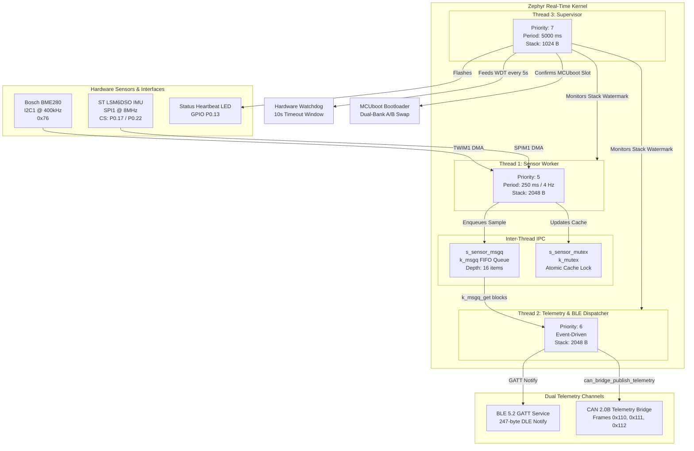
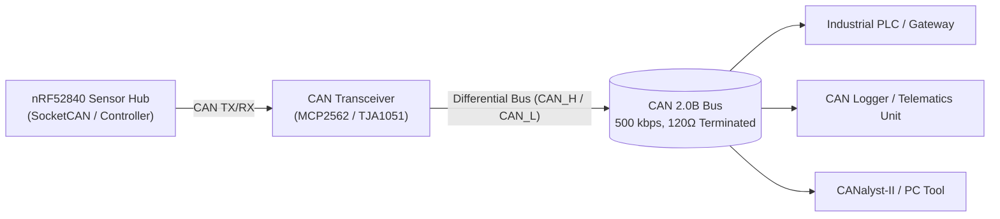

# nRF52840 BLE & CAN Sensor Hub

[](https://github.com/RishobanK/IDE/actions/workflows/firmware_ci.yml)
[](LICENSE)
[](https://zephyrproject.org/)
[](https://www.nordicsemi.com/)
[](https://kicad.org/)

Production-grade edge telemetry firmware and hardware built for the **Nordic nRF52840 SoC** running **Zephyr RTOS**. Integrates environmental and inertial sensor telemetry published simultaneously over a custom **Bluetooth Low Energy (BLE 5.2)** GATT service and an **Industrial CAN 2.0B Bus Bridge**, secured by **MCUboot dual-bank Over-the-Air (OTA)** updates and verified through native **GitHub Actions CI**.

---

## 1. System Architecture & Concurrency Model

The firmware enforces clean task separation with preemptive priorities, lockless inter-thread queues, and non-blocking multi-protocol telemetry broadcasting.



---

## 2. Industrial CAN 2.0B Telemetry Subsystem

The sensor hub acts as an edge bridge broadcasting real-time sensor metrics over an isolated CAN 2.0B network at 500 kbps.



### CAN Frame Matrix (11-Bit Standard IDs)

All telemetry fields are packed in **Little-Endian (Intel)** format:

| Frame ID | DLC | Signal Name | Data Type | Units / Scaling Factor | Valid Range |
|:---:|:---:|---|:---:|:---:|:---:|
| **`0x110`** | 8 | Ambient Temperature | `int16_t` | $0.01\,^\circ\text{C}$ ($2500 \rightarrow 25.00\,^\circ\text{C}$) | $-40.00$ to $+85.00\,^\circ\text{C}$ |
| | | Relative Humidity | `uint16_t` | $0.01\,\%\,\text{RH}$ ($5500 \rightarrow 55.00\,\%\,\text{RH}$) | $0.00$ to $100.00\,\%\,\text{RH}$ |
| | | Barometric Pressure | `uint32_t` | $1\,\text{Pa}$ ($101325 \rightarrow 101325\,\text{Pa}$) | $30000$ to $110000\,\text{Pa}$ |
| **`0x111`** | 6 | Acceleration X | `int16_t` | $1\,\text{mg}$ | $\pm 2000\,\text{mg}$ / $\pm 4000\,\text{mg}$ |
| | | Acceleration Y | `int16_t` | $1\,\text{mg}$ | $\pm 2000\,\text{mg}$ / $\pm 4000\,\text{mg}$ |
| | | Acceleration Z | `int16_t` | $1\,\text{mg}$ | $\pm 2000\,\text{mg}$ / $\pm 4000\,\text{mg}$ |
| **`0x112`** | 6 | Angular Velocity X | `int16_t` | $1\,\text{mdps}$ ($0.001\,^\circ/\text{s}$) | $\pm 2000^\circ/\text{s}$ |
| | | Angular Velocity Y | `int16_t` | $1\,\text{mdps}$ ($0.001\,^\circ/\text{s}$) | $\pm 2000^\circ/\text{s}$ |
| | | Angular Velocity Z | `int16_t` | $1\,\text{mdps}$ ($0.001\,^\circ/\text{s}$) | $\pm 2000^\circ/\text{s}$ |

> **Non-blocking Guarantee:** Transmissions use `can_send(..., K_MSEC(100), ...)` so bus-off conditions or missing acks never block real-time RTOS scheduling.

---

## 3. Hardware SMT & Native KiCad 8/9 Deliverables

Complete production hardware designs are located under [`hardware/`](hardware/):
- **KiCad Project:** [`hardware/nrf52840_sensor_hub.kicad_pro`](hardware/nrf52840_sensor_hub.kicad_pro)
- **Schematic:** [`hardware/nrf52840_sensor_hub.kicad_sch`](hardware/nrf52840_sensor_hub.kicad_sch)
- **4-Layer PCB:** [`hardware/nrf52840_sensor_hub.kicad_pcb`](hardware/nrf52840_sensor_hub.kicad_pcb)
- **Engineering Specification:** [`hardware/HARDWARE_SPEC.md`](hardware/HARDWARE_SPEC.md)
- **Assembly SMT BOM:** [`hardware/bom_jlcpcb.csv`](hardware/bom_jlcpcb.csv)

### 4-Layer PCB Stackup Specifications
- **Layer 1 (F.Cu - 1.0 oz / 35 µm):** High-speed RF GCPW transmission line, digital buses, SMT component pads.
- **Layer 2 (In1.Cu - 0.5 oz / 17.5 µm):** Solid, unbroken Ground Reference Plane.
- **Layer 3 (In2.Cu - 0.5 oz / 17.5 µm):** Power Distribution Plane (`+3V3`, `V_BATT`, `VBUS`).
- **Layer 4 (B.Cu - 1.0 oz / 35 µm):** Low-speed control routing and bottom ground pour.
- **Form Factor:** Compact $50\,\text{mm} \times 35\,\text{mm}$ enclosure footprint with $8.5 \times 5.5\,\text{mm}$ 4-layer antenna keepout zone.

### Power Management Topology
```
USB-C 5V (J2) ──► Microchip MCP73831T (U4) ──► 3.7V LiPo (J3) ──► TI TPS7A2033 (U5) ──► +3V3 System Rail
                  (500mA Fast-Charge, 4.2V)                       (Ultra-Low IQ=6.5µA, 300mA)
```

---

## 4. Hardware Pinout Table

| Peripheral | Signal / Function | nRF52840 Pin | Physical Connection | Electrical Details |
|---|---|---|---|---|
| **Bosch BME280** | I2C1 SDA | **P0.26** | U2 Pin 3 (SDI) | 3.3V, 4.7kΩ pull-up to +3V3 |
| **Bosch BME280** | I2C1 SCL | **P0.27** | U2 Pin 4 (SCK) | 3.3V, 4.7kΩ pull-up to +3V3 |
| **ST LSM6DSO** | SPI1 SCK | **P0.19** / P0.31 | U3 Pin 3 (SPC) | 8 MHz max, Mode 3 (CPOL=1, CPHA=1) |
| **ST LSM6DSO** | SPI1 MOSI | **P0.20** / P0.30 | U3 Pin 2 (SDI) | 3.3V push-pull |
| **ST LSM6DSO** | SPI1 MISO | **P0.21** / P0.29 | U3 Pin 1 (SDO) | 3.3V input |
| **ST LSM6DSO** | SPI1 CS | **P0.22** / P0.17 | U3 Pin 4 (CS) | Active-low GPIO chip-select |
| **ST LSM6DSO** | Data Ready INT | **P0.18** / P0.19 | U3 Pin 5 (INT1) | Active-high rising-edge interrupt |
| **Status LED** | LED1 Heartbeat | **P0.13** | D1 (Green 0603) | Active-low, 5s supervisor toggle |
| **BLE Activity** | LED2 Connect | **P0.14** | D2 (Red 0603) | Active-low, set on connect |
| **SWD Debug** | SWDIO / SWDCLK | SWD Pins | J1 (FTSH-105-01) | Standard 10-pin 1.27mm Cortex debug |
| **USB-C PHY** | VBUS / CC1 / CC2| USB-C Port | J2 (16-Pin Receptacle)| 5.1kΩ pull-downs on CC1/CC2 |

---

## 5. Directory Layout

```
.
├── .github/workflows/
│   └── firmware_ci.yml         # GitHub Actions CI/CD (native test + Cppcheck)
├── app/
│   ├── CMakeLists.txt          # Zephyr application CMake definition
│   ├── prj.conf                # Zephyr Kconfig subsystem flags
│   ├── app.overlay             # Devicetree overlay (I2C1 & SPI1 buses)
│   └── src/
│       ├── main.c              # Thread spawning, queues, supervisor
│       ├── sensor_manager.c    # Sensor bus acquisition and caching
│       ├── ble_service.c       # Custom GATT service, advertising, notify
│       ├── can_bridge.c        # Industrial CAN 2.0B telemetry bridge
│       ├── crash_logger.c      # NVS persistent diagnostic breadcrumbs
│       └── ota_manager.c       # MCUboot self-test and confirmation logic
├── boards/arm/custom_sensor_node/
│   ├── custom_sensor_node.dts  # Full Device Tree: I2C1, SPI1, partitions
│   ├── custom_sensor_node-pinctrl.dtsi # Pin mux states (active + sleep)
│   └── custom_sensor_node_defconfig    # Minimum Kconfig fragment
├── hardware/
│   ├── nrf52840_sensor_hub.kicad_pro   # KiCad 8/9 Project configuration
│   ├── nrf52840_sensor_hub.kicad_sch   # KiCad 8/9 Schematic (clean sub-unit S-expressions)
│   ├── nrf52840_sensor_hub.kicad_pcb   # KiCad 8/9 4-Layer PCB layout
│   ├── HARDWARE_SPEC.md        # Comprehensive schematic & manufacturing spec
│   └── bom_jlcpcb.csv          # Automated JLCPCB / PCBWay SMT BOM
├── include/
│   ├── sensor_manager.h        # Sensor structures & IPC queue headers
│   ├── ble_service.h           # GATT UUIDs and configuration structs
│   ├── can_bridge.h            # CAN 2.0B frame definitions and API
│   ├── crash_logger.h          # NVS crash logging interface
│   └── ota_manager.h           # Bootloader lifecycle interface
├── tests/
│   └── test_sensor_ringbuf.c   # Unit tests for queue boundary and FIFO
├── build_and_sign.sh           # Automated build, imgtool signing, and packaging
├── TECHNICAL_SUMMARY.md        # Deep architectural and quantifiable metrics
└── README.md                   # Project overview and quickstart guide
```

---

## 6. Quickstart: Build & Execution Instructions

### Prerequisites
- [nRF Connect SDK v2.6.x](https://developer.nordicsemi.com/nRF_Connect_SDK/doc/latest/nrf/installation.html) or Zephyr RTOS v3.5+
- `west` meta-tool (`pip install west`)
- GNU Arm Embedded Toolchain (`arm-zephyr-eabi`)
- Segger J-Link Tools (`nrfjprog` or `JLinkExe`)

### 1. Build for the Custom Production Board (`west build`)
```bash
# Initialize and fetch dependencies
west init -l app
west update

# Compile for custom production sensor node
west build -b custom_sensor_node app -d build
```

### 2. Flash to Target Hardware via Segger J-Link
```bash
west flash -d build
```

### 3. Real-Time Debug Logging via Segger RTT
```bash
JLinkRTTViewer --device NRF52840_XXAA --interface SWD --speed 4000
```

### 4. Automated Signing & MCUboot OTA Image Generation
```bash
chmod +x build_and_sign.sh
./build_and_sign.sh custom_sensor_node 1.0.0
# Outputs signed binary ready for OTA: build/zephyr/zephyr.signed.bin
```

---

## 7. Unit Testing & CI/CD Pipeline

Host-native unit tests run on developer workstations or in continuous integration without hardware dependencies:

### Running Unit Tests Locally
```bash
gcc -Wall -Wextra -O2 tests/test_sensor_ringbuf.c -o test_ringbuf
./test_ringbuf
```

Expected Output:
```
Running sensor_ringbuf unit tests...
  [PASS] test_ringbuf_empty_initial_state
  [PASS] test_ringbuf_fifo_ordering
  [PASS] test_ringbuf_overrun_drop_oldest
All 3 unit tests passed successfully!
```

### Automated GitHub Actions CI Matrix
The workflow in `.github/workflows/firmware_ci.yml` executes on every push/PR to `main` and `master`:
- **Native Unit Test Job:** Compiles and runs test suites using host GCC in $<10\,\text{seconds}$.
- **Cppcheck Static Analysis:** Scans `app/src/` for memory leaks, undefined behavior, and style defects in $<15\,\text{seconds}$.

---

## 8. License
This project is licensed under the Apache 2.0 License. See [LICENSE](LICENSE) for details.
