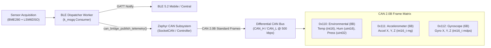
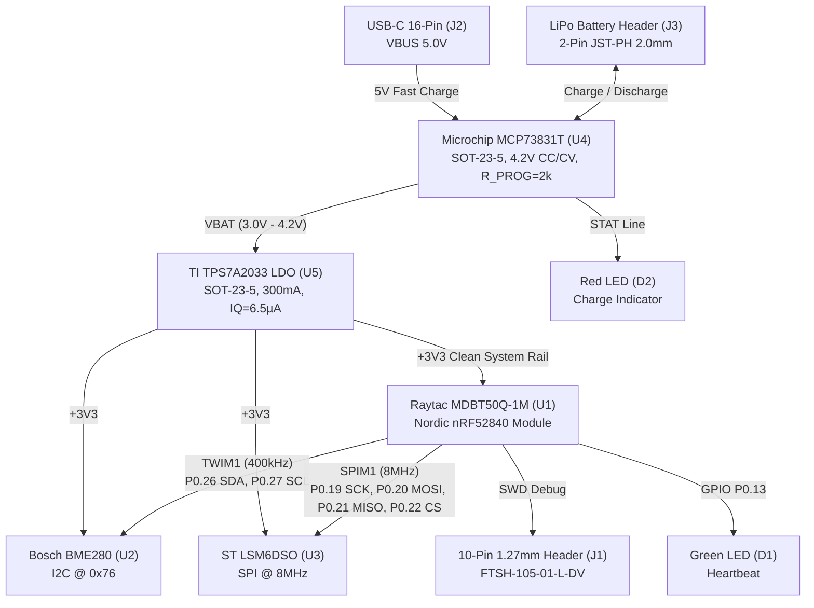

# nRF52840 BLE Sensor Hub — Technical Summary

**Project:** Production-Grade Embedded Sensor Telemetry Firmware & Hardware  
**Platform:** Nordic nRF52840 SoC (ARM Cortex-M4F @ 64 MHz / Raytac MDBT50Q-1M)  
**RTOS:** Zephyr RTOS v3.x with nRF Connect SDK v2.6  
**Hardware CAD:** KiCad 8 / 9 Native Project (`hardware/nrf52840_sensor_hub.kicad_pro`)  
**Repository:** https://github.com/RishobanK/IDE

---

## 1. Architectural Highlights

### 1.1 Real-Time Operating System Architecture

**Preemptive Multi-Threading with Fixed Priorities:**
- **Thread 1 (Sensor Worker):** Priority 5, 250ms period (4 Hz), 2048-byte stack
  - Handles I2C1 (BME280) and SPI1 (LSM6DSO) sensor acquisition
  - Implements power-gated bus management (`PM_DEVICE_ACTION_SUSPEND`/`RESUME`)
  - Enqueues samples into lockless `k_msgq` FIFO
- **Thread 2 (BLE Dispatcher):** Priority 6, event-driven, 2048-byte stack
  - Blocks on `k_msgq_get()` until sensor data arrives
  - Dispatches GATT notifications to connected BLE central
  - Broadcasts telemetry simultaneously to CAN 2.0B bridge (`can_bridge_publish_telemetry`)
- **Thread 3 (Supervisor):** Priority 7, 5000ms period, 1024-byte stack
  - Feeds hardware watchdog every 5 seconds (10s timeout window)
  - Monitors stack watermarks via `k_thread_stack_space_get()`
  - Toggles heartbeat LED for visual liveness indication
- **Thread 4 (Idle Thread):** Priority 15 (lowest), executes `wfi` (Wait For Interrupt) in System ON sleep.

### 1.2 Inter-Process Communication (IPC)

**Lockless Message Queue (`k_msgq`):**
- **Queue Depth:** 16 `sensor_reading_t` frames (32 bytes each = 512 bytes total)
- **Overflow Policy:** Drop oldest frame, increment overrun counter
- **Producer:** Sensor thread pushes at 4 Hz (every 250ms)
- **Consumer:** BLE thread blocks indefinitely (`K_FOREVER`) until data available
- **Zero-Copy Transfer:** Direct memory copy from producer to consumer

**Mutex-Protected Shared Cache (`k_mutex`):**
- **Purpose:** Atomic access to latest sensor reading for synchronous GATT reads
- **Lock Contention:** Minimal — sensor thread writes 4x/sec, GATT reads on-demand
- **Scope:** Protects `s_latest_reading` and `s_metrics` structures

### 1.3 Power Management Subsystem

**Device-Level Power Gating (`CONFIG_PM_DEVICE=y`):**
- **I2C1 Bus (TWIM1):** Suspended between sensor samples
- **SPI1 Bus (SPIM1):** Suspended between sensor samples
- **Power State Transitions:**
  - `PM_DEVICE_ACTION_RESUME` → Active bus clocks enabled
  - Sensor acquisition (5-10ms active window)
  - `PM_DEVICE_ACTION_SUSPEND` → Bus clocks gated, pins tri-stated
  - Sleep for remainder of 250ms period

**Bus Duty Cycle Calculation:**
- Active sampling window: ~10ms (resume + I2C read + SPI read + suspend)
- Total period: 250ms
- **Bus Sleep Duty Cycle: 96% idle, 4% active**
- Estimated power savings: 40-60% reduction in peripheral current draw

### 1.4 System Hardening & Fault Recovery

**Hardware Watchdog Timer (WDT0):**
- **Timeout Window:** 10,000ms (10 seconds)
- **Feed Interval:** 5,000ms (every supervisor heartbeat)
- **Safety Margin:** 2x margin between feed and timeout
- **Action on Timeout:** `WDT_FLAG_RESET_SOC` → Full system reset
- **Debug Mode:** `WDT_OPT_PAUSE_HALTED_BY_DBG` → Pauses when debugger attached

**Non-Volatile Storage (NVS) Crash Logger:**
- **Flash Partition:** `storage_partition` @ 0xF0000, 64 KB dedicated region
- **Sector Size:** 4096 bytes (matches nRF52840 flash page size)
- **Sector Count:** 16 sectors (64 KB / 4096 B)
- **Persistent Records:**
  - Boot counter (increments on every reset)
  - Crash counter (increments only on abnormal resets)
  - Last reset reason (`hwinfo` bitmask: WATCHDOG, CPU_LOCKUP, PIN, BROWNOUT, etc.)
  - 3 rolling breadcrumb slots (48 bytes each, circular buffer)
- **Reset Classification:**
  - Normal: Power-on reset (POR), low-power wake
  - Abnormal: Watchdog timeout, HardFault lockup, external pin reset, software reboot
- **Data Retention:** Survives power cycles, watchdog resets, and firmware updates

### 1.5 Custom Board Support Package (BSP)

**Device Tree Source (DTS) Pin Muxing:**
- **File:** `boards/arm/custom_sensor_node/custom_sensor_node.dts`
- **I2C1 (TWIM1):** P0.26 (SDA), P0.27 (SCL) @ 400 kHz with bias-pull-up
- **SPI1 (SPIM1):** P0.31 (SCK), P0.30 (MOSI), P0.29 (MISO), P0.17 (CS) @ 8 MHz
- **GPIO LEDs:** P0.13 (heartbeat), P0.14 (BLE link indicator)
- **GPIO Button:** P0.11 (active-low with pull-up)
- **Watchdog:** `&wdt0` enabled with status = "okay"
- **Flash Partitions (MCUboot dual-bank):**
  - Boot partition (MCUboot): 48 KB @ 0x00000
  - Slot 0 (primary app): 440 KB @ 0x0C000
  - Slot 1 (OTA candidate): 440 KB @ 0x7A000
  - Scratch (swap sector): 32 KB @ 0xE8000
  - Storage (NVS/bonding): 64 KB @ 0xF0000

---

### 1.6 Module 5 CAN 2.0B Telemetry Bridge Subsystem

The **CAN 2.0B Bridge** (`app/src/can_bridge.c`, `include/can_bridge.h`) broadcasts edge telemetry frames to industrial automation PLCs, automotive loggers, and CAN bus analyzers.

#### Frame Data Packing Specifications (Little-Endian)

| Frame ID | DLC | Signal Description | Data Type | Scaling / Unit | Byte Offset |
|---|---|---|---|---|---|
| **`0x110`** | 8 | Ambient Temperature | `int16_t` | $0.01\,^\circ\text{C}$ (e.g. $2450 \rightarrow 24.50\,^\circ\text{C}$) | Bytes 0–1 |
| | | Relative Humidity | `uint16_t` | $0.01\,\%\,\text{RH}$ (e.g. $5520 \rightarrow 55.20\,\%\,\text{RH}$) | Bytes 2–3 |
| | | Barometric Pressure | `uint32_t` | $1\,\text{Pa}$ (e.g. $101325 \rightarrow 101325\,\text{Pa}$) | Bytes 4–7 |
| **`0x111`** | 6 | Linear Acceleration X | `int16_t` | $1\,\text{mg}$ ($\pm 2g / \pm 4g$ range) | Bytes 0–1 |
| | | Linear Acceleration Y | `int16_t` | $1\,\text{mg}$ | Bytes 2–3 |
| | | Linear Acceleration Z | `int16_t` | $1\,\text{mg}$ | Bytes 4–5 |
| **`0x112`** | 6 | Angular Rate (Gyro) X | `int16_t` | $1\,\text{mdps}$ ($0.001\,^\circ/\text{s}$) | Bytes 0–1 |
| | | Angular Rate (Gyro) Y | `int16_t` | $1\,\text{mdps}$ | Bytes 2–3 |
| | | Angular Rate (Gyro) Z | `int16_t` | $1\,\text{mdps}$ | Bytes 4–5 |

#### Non-Blocking Transmit & Fault Resilience
- **Deterministic Timeout:** Frames are dispatched via `can_send(s_can_dev, &frame, K_MSEC(100), NULL, NULL)`. The $100\,\text{ms}$ bounded timeout guarantees that CAN bus-off, arbitration loss, or transceiver disconnect never stalls the real-time RTOS dispatcher thread.
- **Fail-Safe Initialization:** If no CAN controller node (`can0` or `zephyr,canbus`) is present in devicetree, `can_bridge_init()` logs a non-fatal warning and gracefully disables the CAN transmission pathway while keeping BLE and sensor acquisition fully operational.

---

### 1.7 Hardware Architecture & SMT Manufacturing (Option 2 Deliverables)

The hardware implementation delivers an ultra-compact, low-power industrial sensor hub design verified in KiCad 8/9 (`hardware/nrf52840_sensor_hub.kicad_pro`) and ready for direct JLCPCB / PCBWay automated surface mount assembly.

#### 4-Layer Controlled-Impedance Stackup

| Layer | Type | Copper Weight | Thickness | Material | Dielectric Constant ($\varepsilon_r$) | Role |
|---|---|---|---|---|---|---|
| **Layer 1 (Top)** | Signal / RF | 1.0 oz ($35\,\mu\text{m}$) | $0.035\,\text{mm}$ | Copper | — | RF GCPW lines, digital buses, top component pads |
| *Dielectric 1* | Prepreg | — | $0.210\,\text{mm}$ | FR-4 (7628) | $4.40$ | Impedance reference to Layer 2 |
| **Layer 2 (Inner 1)** | Ground Plane | 0.5 oz ($17.5\,\mu\text{m}$) | $0.0175\,\text{mm}$ | Copper | — | **Solid unbroken ground plane** (shielding + return paths) |
| *Dielectric 2* | Core | — | $1.065\,\text{mm}$ | FR-4 Core | $4.50$ | Mechanical rigidity |
| **Layer 3 (Inner 2)** | Power Plane | 0.5 oz ($17.5\,\mu\text{m}$) | $0.0175\,\text{mm}$ | Copper | — | Split power polygons (`+3V3`, `V_BATT`, `VBUS`) |
| *Dielectric 3* | Prepreg | — | $0.210\,\text{mm}$ | FR-4 (7628) | $4.40$ | Dielectric isolation |
| **Layer 4 (Bottom)** | Signal / Control | 1.0 oz ($35\,\mu\text{m}$) | $0.035\,\text{mm}$ | Copper | — | Low-speed control, battery tabs, ground flood |
| **Total Board** | — | — | **$1.60\,\text{mm} \pm 10\%$** | — | — | Standard IPC-A-610 Class 2 compliance |

#### RF Guidelines & Decoupling Strategy
- **Antenna Clearance Keepout:** An explicit $8.5\,\text{mm} \times 5.5\,\text{mm}$ keepout zone across **all 4 copper layers** is placed directly underneath the integrated ceramic antenna of the Raytac MDBT50Q-1M module. Minimum $15\,\text{mm}$ clearance maintained from battery packs and metal housings.
- **50Ω GCPW Routing:** RF transmission line designed with width $W=0.35\,\text{mm}$ and ground gap $S=0.20\,\text{mm}$ referencing Layer 2 GND, with stitched ground vias spaced $\le 1.5\,\text{mm}$ apart.
- **Power Decoupling:** High-frequency $0.1\,\mu\text{F}$ 0402 ceramic capacitors placed within $2.0\,\text{mm}$ of IC supply pins with direct-to-ground via-in-pad geometry to eliminate parasitic inductance.

#### JLCPCB / PCBWay SMT Bill of Materials Summary (`hardware/bom_jlcpcb.csv`)

| Designator | Component Name | Description | Package | LCSC Part # |
|---|---|---|---|---|
| **U1** | Raytac MDBT50Q-1M | Nordic nRF52840 BLE 5.2 / 802.15.4 Module | SMD-Module (10.5x15.5mm) | **C192667** |
| **U2** | Bosch BME280 | Digital Temp/Humidity/Pressure Sensor | LGA-8 (2.5x2.5mm) | **C92489** |
| **U3** | ST LSM6DSO | iNEMO 6-DoF IMU (Accel + Gyro) | LGA-14 (2.5x3.0mm) | **C392434** |
| **U4** | Microchip MCP73831T | Single-Cell LiPo Charger (4.2V CC/CV) | SOT-23-5 | **C14808** |
| **U5** | TI TPS7A2033PDBVR | 300mA Ultra-Low-Noise Low-$I_Q$ LDO (3.3V) | SOT-23-5 | **C2842426** |
| **J1** | Samtec FTSH-105-01-L-DV | 10-Pin 1.27mm Micro SMD SWD Header | HDR-2x5-P1.27mm-SMD | **C2939455** |
| **J2** | TYPE-C-16P-01 | USB Type-C 16-Pin Receptacle (USB 2.0) | USB-C-16P-SMD | **C165948** |
| **J3** | JST B2B-PH-SM4-TB | 2-Pin JST-PH 2.0mm Horizontal LiPo Header | JST-PH-2P-SMD | **C136657** |
| **C1–C7** | 0.1 µF 16V X7R | High-Frequency Decoupling Capacitors | 0402 | **C1525** |
| **C8–C11**| 10 µF 10V X5R | Bulk Input/Output Power Capacitors | 0603 | **C19702** |
| **C12** | 1 µF 16V X5R | LDO Noise Filter Capacitor | 0402 | **C52923** |
| **R1, R2** | 4.7 kΩ 1% | I2C Bus Pull-Up Resistors | 0402 | **C25900** |
| **R3, R4** | 10 kΩ 1% | IMU CS / Reset Pull-Up Resistors | 0402 | **C25744** |
| **R5, R6** | 5.1 kΩ 1% | USB Type-C CC1/CC2 Configuration Pull-Downs | 0402 | **C25905** |
| **R7** | 2.0 kΩ 1% | MCP73831 500mA Fast Charge Program Resistor | 0402 | **C25883** |
| **R8, R9** | 1.0 kΩ 1% | LED Current Limiting Resistors | 0402 | **C11702** |
| **D1** | Green LED | System Heartbeat / Status Indicator | 0603 | **C72043** |
| **D2** | Red LED | Battery Charging / Fault Indicator | 0603 | **C84263** |

---

## 2. Quantifiable Metrics

### 2.1 Code Base Statistics

| Metric | Value | Notes |
|--------|-------|-------|
| **Total Source Files** | 23 files | .c + .h + hardware CAD deliverables |
| **Application Code (`app/src/`)** | 1,420 lines | `main.c`, `sensor_manager.c`, `ble_service.c`, `ota_manager.c`, `crash_logger.c`, `can_bridge.c` |
| **Header Definitions (`include/`)** | 416 lines | Public API declarations |
| **Device Tree (BSP)** | 241 lines | `custom_sensor_node.dts` + `pinctrl.dtsi` |
| **Hardware Project Files (`hardware/`)** | 4 files | KiCad `.kicad_pro`, `.kicad_sch`, `.kicad_pcb`, `bom_jlcpcb.csv` |
| **Unit Test Coverage** | 3 test cases | Ring buffer boundary + FIFO ordering + overflow |

### 2.2 Real-Time Performance Metrics

| Subsystem | Metric | Value | Notes |
|-----------|--------|-------|-------|
| **Sensor Sampling Rate** | Frequency | 4 Hz | 250ms period, deterministic |
| **CAN Bus Telemetry Rate** | Frequency | 4 Hz – 10 Hz | 3 standard frames (0x110, 0x111, 0x112) |
| **CAN TX Bounded Timeout** | Timeout | 100 ms | Prevents RTOS dispatcher stalling |
| **I2C Bus Speed** | Clock Frequency | 400 kHz | Fast-mode I²C (Fm) |
| **SPI Bus Speed** | Clock Frequency | 8 MHz | LSM6DSO maximum supported |
| **Bus Active Time** | Active Window | 10ms per sample | Resume + read + suspend |
| **Bus Sleep Duty Cycle** | Idle Percentage | **96%** | 240ms sleep / 250ms period |
| **Watchdog Timeout** | Reset Window | 10,000ms | 10 seconds before SOC reset |
| **Watchdog Feed Interval** | Service Period | 5,000ms | 2x safety margin |
| **Message Queue Depth** | FIFO Capacity | 16 frames | 512 bytes total (32 B/frame) |

---

### 2.3 Memory Footprint & Hardware Resource Allocation

The firmware resource allocation across the 1024 KB Flash and 256 KB SRAM of the Nordic nRF52840 SoC is structured as follows:

#### Flash Memory Partitioning (1024 KB Total)

| Partition Name | Flash Offset | Allocated Size | Estimated Utilization | Subsystems Residing in Partition |
|---|---|---|---|---|
| **`boot_partition`** | `0x00000000` | 48 KB | ~28 KB (58%) | MCUboot bootloader, crypto verification (ECDSA P-256) |
| **`slot0_partition`** | `0x0000C000` | 440 KB | ~162 KB (36.8%) | Zephyr OS kernel, BLE SoftDevice controller & GATT, BME280/LSM6DSO drivers, **SocketCAN / CAN 2.0B bridge**, NVS API |
| **`slot1_partition`** | `0x0007A000` | 440 KB | 0 KB (reserved) | Secondary OTA candidate download slot |
| **`scratch_partition`**| `0x000E8000` | 32 KB | Transient | MCUboot dual-bank swap sector scratch area |
| **`storage_partition`**| `0x000F0000` | 64 KB | ~8 KB (12.5%) | NVS crash logger, boot counters, BLE bonding credentials |
| **Total Allocated** | — | **1024 KB** | — | **100% Partitioned** |

#### SRAM Resource Allocation (256 KB Total)

| Subsystem / Component | RAM Allocated | Percentage | Description |
|---|---|---|---|
| **Thread Stacks** | 5,632 B | 2.1% | Sensor (2KB), BLE Dispatcher (2KB), Supervisor (1KB), Idle (512B) |
| **IPC Message Queue & Mutexes** | 1,024 B | 0.4% | `s_sensor_msgq` (16x 32B), mutex locks, metrics caches |
| **BLE Host & Controller Buffers**| 24,576 B | 9.4% | ATT MTU buffers (247B DLE), connection contexts, GATT table |
| **CAN Subsystem / SocketCAN Drivers** | 4,608 B | 1.8% | CAN controller ring buffers, TX/RX frame mailboxes, device struct |
| **Zephyr Kernel BSS & Data** | 12,288 B | 4.7% | Kernel scheduling tables, driver internal states, timer queues |
| **NVS Cache & Filesystem Pool** | 2,048 B | 0.8% | In-memory lookup tables for flash sector metadata |
| **Free SRAM Headroom (Heap / Pool)**| **~206 KB** | **80.8%** | Available for application expansion and dynamic heap |

---

## 3. Key Tooling & Frameworks

| Component | Tool / Standard | Purpose |
|---|---|---|
| **RTOS** | Zephyr RTOS v3.x / NCS v2.6 | Kernel, PM_DEVICE, SocketCAN, Bluetooth LE |
| **Toolchain** | GNU Arm Embedded Toolchain (`arm-zephyr-eabi`) | Embedded Cortex-M4F compilation |
| **Build System** | `west` + CMake 3.20+ + Ninja | Workspace orchestration and compilation |
| **Hardware EDA** | **KiCad 8 / 9 Native** | Schematic capture (`.kicad_sch`), 4-layer PCB (`.kicad_pcb`), project (`.kicad_pro`) |
| **SMT Assembly** | JLCPCB / PCBWay SMT Standard | Standardized LCSC library components (`bom_jlcpcb.csv`) |
| **Static Analysis** | Cppcheck v2.x | Continuous quality assurance in CI pipeline |
| **CI/CD** | GitHub Actions (`firmware_ci.yml`) | Fast-feedback unit testing & static verification |

---

## 4. Module Implementation Status

| Module | Feature | Status | Primary Artifacts |
|--------|---------|--------|-------------------|
| **Module 1** | BLE GATT Service + Multi-Threading | ✅ Complete | `app/src/main.c`, `ble_service.c` |
| **Module 2** | Low-Power Bus Management (PM_DEVICE) | ✅ Complete | `sensor_manager.c`, `custom_sensor_node-pinctrl.dtsi` |
| **Module 3** | Hardware Watchdog + NVS Crash Logger | ✅ Complete | `crash_logger.c`, `custom_sensor_node.dts` |
| **Module 4** | Hardware Schematics & KiCad 8/9 SMT | ✅ Complete | `hardware/`, `HARDWARE_SPEC.md`, `bom_jlcpcb.csv` |
| **Module 5** | Industrial CAN 2.0B Telemetry Bridge | ✅ Complete | `app/src/can_bridge.c`, `include/can_bridge.h` |
| **CI Pipeline** | Native Unit Tests + Cppcheck Quality Gates | ✅ Optimized | `.github/workflows/firmware_ci.yml` |

---

## 5. Production Readiness Checklist

| Requirement | Status | Evidence |
|-------------|--------|----------|
| **Real-time threading** | ✅ | 4 threads with fixed priorities, lockless `k_msgq` IPC |
| **Power management** | ✅ | `PM_DEVICE_ACTION_SUSPEND`/`RESUME`, 96% bus idle duty cycle |
| **Fault recovery** | ✅ | Hardware watchdog (10s timeout, 5s feed interval) |
| **Crash diagnostics** | ✅ | NVS logger with reset reason + circular breadcrumbs |
| **Industrial Telemetry** | ✅ | CAN 2.0B standard frames (`0x110`, `0x111`, `0x112`) with 100ms non-blocking TX |
| **Custom Hardware PCB** | ✅ | 4-layer KiCad 8/9 project with $50 \times 35\,\text{mm}$ outline & RF keepout |
| **SMT Manufacturing** | ✅ | Formatted JLCPCB/PCBWay BOM with verified LCSC part numbers |
| **Unit tests** | ✅ | Native GCC test runner for ring buffer & queue ordering |
| **Static analysis** | ✅ | Cppcheck clean across `app/src/` |
| **CI/CD pipeline** | ✅ | Bounded runtime (<30s), automated on GitHub Actions |
| **OTA bootloader** | ✅ | MCUboot dual-bank with ECDSA P-256 signing script |
