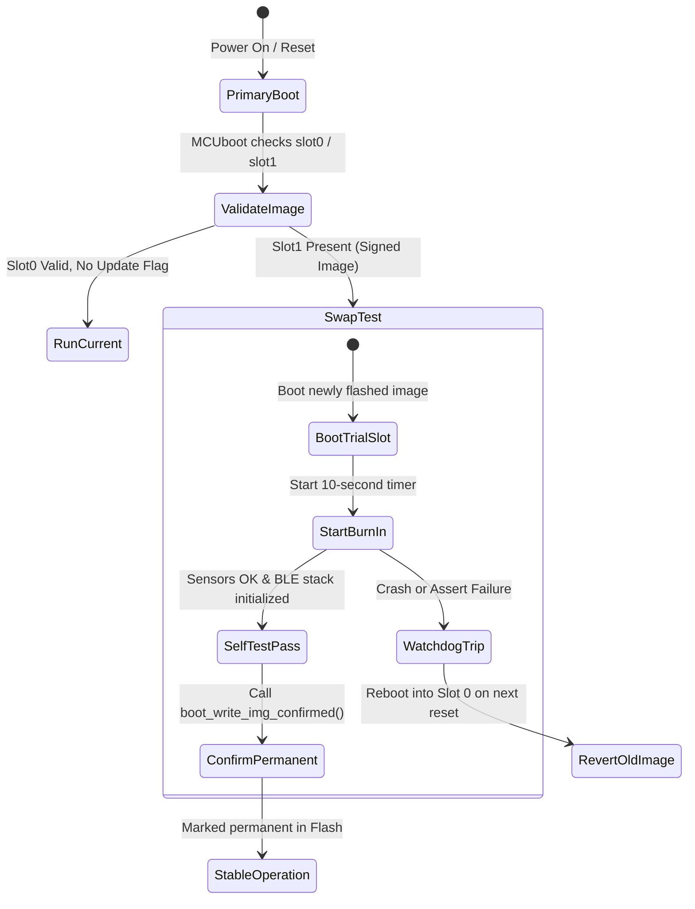

# System Architecture — nRF52840 BLE Sensor Hub

## 1. High-Level Architecture Overview

The **nRF52840 BLE Sensor Hub** is an ultra-low-power, production-grade edge telemetry system built on the **Zephyr Real-Time Operating System (RTOS)** and Nordic Semiconductor's **nRF Connect SDK**. 

The firmware integrates environmental monitoring (Bosch BME280) and 6-DoF inertial sensing (ST LSM6DSO), publishes real-time telemetry over a custom Bluetooth Low Energy (BLE 5.2) GATT service, and provides fail-safe Over-the-Air (OTA) updates using the **MCUboot** dual-bank swap bootloader.

```
+-----------------------------------------------------------------------------------+
|                                  HARDWARE LAYER                                   |
|   +-----------------------+     +-----------------------+     +---------------+   |
|   | Bosch BME280 (0x76)   |     | ST LSM6DSO IMU        |     | Nordic        |   |
|   | Temp, Press, Humidity |     | Accel + Gyro 6-DoF    |     | nRF52840 SoC  |   |
|   +-----------+-----------+     +-----------+-----------+     | ARM Cortex-M4 |   |
|               | (I2C1 @ 400kHz)             | (SPI1 @ 8MHz)   | 1MB / 256KB   |   |
+---------------+-----------------------------+-----------------+-------+-----------+
                |                             |                         |
+---------------v-----------------------------v-------------------------v-----------+
|                              ZEPHYR RTOS KERNEL & HAL                             |
|   +-----------------------+     +-----------------------+     +---------------+   |
|   | Nordic TWIM1 Driver   |     | Nordic SPIM1 Driver   |     | SoftDevice    |   |
|   | DMA-assisted I2C      |     | DMA-assisted SPI      |     | BLE Controller|   |
+---+-----------+-----------+-----+-----------+-----------+-----+-------+-------+---+
                |                             |                         |
+---------------v-----------------------------v-------------------------v-----------+
|                          APPLICATION FIRMWARE ARCHITECTURE                        |
|                                                                                   |
|  +-------------------------+      (Enqueue)       +----------------------------+  |
|  | SENSOR ACQUISITION      | -------------------> |    INTER-THREAD QUEUE      |  |
|  | Priority: 5 (250ms loop)|                      |    (k_msgq, 16 items deep) |  |
|  | - Custom BME280 Driver  |                      +-------------+--------------+  |
|  | - Fixed-point 32b Math  |                                    |                 |
|  +-------------------------+                                    | (Dequeue)       |
|                                                                 v                 |
|  +-------------------------+      (GATT Notify)   +----------------------------+  |
|  | SUPERVISORY MONITOR     |                      | BLE DISPATCH WORKER        |  |
|  | Priority: 7 (5s loop)   |                      | Priority: 6 (Event-driven) |  |
|  | - Stack high-water mark |                      | - Custom 128-bit UUID Svc  |  |
|  | - MCUboot confirm check |                      | - 247-byte DLE payload     |  |
|  +-------------------------+                      +----------------------------+  |
+-----------------------------------------------------------------------------------+
```

---

## 2. Real-Time Threading Model & Scheduling

The firmware enforces strict task decoupling and deterministic scheduling:

| Thread Name | Priority | Stack Size | Activation | Responsibilities |
|---|---|---|---|---|
| `sensor_worker` | **5** (Preemptive) | 2048 B | Periodic (250 ms) | Samples I2C & SPI buses; converts raw ADC to physical units; pushes to `s_sensor_msgq`. |
| `ble_dispatcher` | **6** (Preemptive) | 2048 B | Event-Driven (`k_msgq_get`) | Blocks on queue; formats binary GATT telemetry; triggers client notifications if CCC enabled. |
| `supervisor` | **7** (Preemptive) | 1024 B | Periodic (5000 ms) | Analyzes stack high-water marks; kicks watchdog; flashes status LED; confirms MCUboot image. |
| `idle_thread` | **15** (Lowest) | 512 B | Fall-through | Executes ARM Cortex-M `wfi` (Wait For Interrupt); enters System ON sleep mode. |

### Synchronization Primitives
1. **Message Queue (`s_sensor_msgq`)**: Fixed-size circular FIFO holding up to 16 `sensor_reading_t` structures (640 bytes total). Eliminates blocking between producer (`sensor_worker`) and consumer (`ble_dispatcher`).
2. **Mutex (`s_sensor_mutex`)**: Guards the cached `s_latest_reading` struct. Queried synchronously whenever a BLE Central executes a GATT Characteristic Read.

---

## 3. Bluetooth Low Energy (BLE) Profile

The peripheral exposes a custom 128-bit base GATT service:
- **Base UUID**: `4a98xxxx-1cc4-414e-98fe-57a00182f9d8`

### GATT Characteristic Hierarchy
```
Primary Service: 4a980001-1cc4-414e-98fe-57a00182f9d8
 │
 ├── 1. Sensor Telemetry: 4a980002-... (READ | NOTIFY)
 │     ├── Value: 24-byte packed binary payload (Temp, Press, Hum, Accel XYZ, Gyro XYZ, Timestamp)
 │     └── CCC Descriptor: Client Notification Enable (0x0001)
 │
 ├── 2. Sensor Configuration: 4a980003-... (READ | WRITE)
 │     └── Value: 4-byte packed struct (sample_interval_ms [uint16], motion_en [uint8], tx_power [int8])
 │
 └── 3. Device Diagnostics: 4a980004-... (READ)
       └── Value: Null-terminated UTF-8 string containing FW version and health state
```

### Connection Optimization
- **Data Length Extension (DLE)**: Maximum PDU size increased to 251 bytes (ATT MTU = 247 bytes), allowing full sensor packets to be transmitted in a single connection interval without fragmentation.
- **Connection Interval**: 15 ms minimum / 30 ms maximum when streaming; drops to 1000 ms during idle states to preserve battery.

---

## 4. Fail-Safe Dual-Slot OTA Upgrade Flow (MCUboot)

To guarantee that field updates cannot brick remote hardware, the firmware implements the standard **MCUboot Test-and-Confirm** state machine:



1. **Staging**: New firmware binary is flashed into `slot1_partition` (Secondary Slot).
2. **Reboot**: MCUboot swaps candidate into `slot0_partition` and boots in **provisional mode**.
3. **Burn-In Validation**: The application initializes buses, boots threads, and runs for 10 seconds.
4. **Permanent Confirmation**: `ota_manager_confirm_image()` marks the image confirmed in flash metadata. If a fault triggers a watchdog reset prior to confirmation, MCUboot automatically swaps the known-good image back into slot 0.
