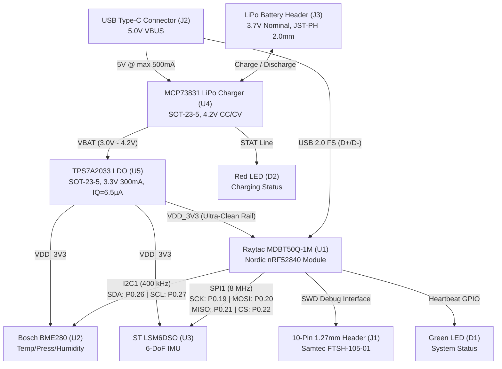

# Hardware Schematic Specifications & SMT Manufacturing Deliverables

**Document Revision:** 1.0.0  
**Target Architecture:** Nordic Semiconductor nRF52840 SoC (Raytac MDBT50Q-1M)  
**Assembly Standard:** IPC-A-610 Class 2 / JLCPCB & PCBWay Automated SMT  
**PCB Stackup:** 4-Layer FR-4 Standard (1.6 mm thickness, 1 oz / 0.5 oz / 0.5 oz / 1 oz copper)  

---

## 1. System Overview & Architecture

The **Custom Sensor Node** is a high-reliability, ultra-low-power industrial and environmental sensing node. The hardware integrates a 64 MHz ARM Cortex-M4F processor with 2.4 GHz multi-protocol radio (BLE 5.2 / 802.15.4), precision barometric and humidity sensing (Bosch BME280), 6-DoF inertial sensing (ST LSM6DSO), integrated USB-C battery charging, and sub-microamp low-dropout voltage regulation.



---

## 2. System Power Architecture

### 2.1 Power Rail Stages

1. **VBUS (5.0V Input)**: Supplied through the 16-pin USB Type-C receptacle ([J2](file:///e:/Antigravity/IDE/hardware/bom_jlcpcb.csv)). Protected via ultra-fast clamping ESD suppressor diodes.
2. **MCP73831 Charge Controller (U4)**:
   - Input: VBUS (4.5V to 6.0V operating range).
   - Battery Chemistry: Single-cell Lithium-Ion / Lithium-Polymer (4.20V ±0.75% float voltage).
   - Fast-Charge Current ($I_{REG}$): Configured via external resistor $R_7$ on pin 5 (`PROG`):
     $$I_{REG} = \frac{1000\text{ V}}{R_{PROG}} = \frac{1000\text{ V}}{2000\,\Omega} = 500\text{ mA}$$
   - Charge Status: Open-drain `STAT` output driving Red Indicator LED ([D2](file:///e:/Antigravity/IDE/hardware/bom_jlcpcb.csv)).
     - *Pre-charge / Fast-charge*: Output pulled LOW (LED active).
     - *Charge complete*: High-impedance OFF (LED unlit).
     - *No supply / Shutdown*: High-impedance OFF.
3. **VBAT (3.0V – 4.2V Battery Rail)**: Connects to the JST-PH 2.0mm 2-pin connector ([J3](file:///e:/Antigravity/IDE/hardware/bom_jlcpcb.csv)). Provides direct input to the linear regulator stage.
4. **TPS7A2033 Low-Dropout Regulator (U5)**:
   - Output Voltage: Fixed 3.3V ($V_{OUT} = 3.3\text{ V} \pm 1\%$).
   - Current Capability: 300 mA continuous.
   - Ultra-Low Quiescent Current: $I_Q = 6.5\text{ }\mu\text{A}$ typical across temperature.
   - Ultra-Low Dropout: $V_{DO} = 140\text{ mV}$ at 300 mA load (operates down to $V_{IN} = 3.44\text{ V}$ at full load, down to $3.35\text{ V}$ at light load).
   - High Power Supply Rejection Ratio (PSRR): $95\text{ dB}$ at 1 kHz, providing an ultra-quiet rail for sensor analog front-ends and radio VCOs.

### 2.2 System Power Budget & Battery Life Calculation

*Assumed Battery Capacity: 500 mAh single-cell LiPo (1.85 Wh nominal).*

| Operating State | nRF52840 | BME280 | LSM6DSO | TPS7A2033 $I_Q$ | Total Current | Est. Runtime (500 mAh) |
|---|---|---|---|---|---|---|
| **System OFF (Deep Sleep)** | 0.4 µA | 0.1 µA | 3.0 µA | 6.5 µA | **10.0 µA** | **~5.7 years** |
| **Idle Standby (RTC Running)** | 1.5 µA | 0.2 µA | 5.5 µA | 6.5 µA | **13.7 µA** | **~4.1 years** |
| **Periodic Sensor Sample (1 Hz)** | 4.8 mA (3ms) | 3.6 µA avg | 170 µA (26Hz) | 6.5 µA | **~245 µA avg** | **~85 days** |
| **Active BLE Telemetry (30ms Conn)** | 7.2 mA (avg) | 3.6 µA avg | 170 µA (26Hz) | 6.5 µA | **~7.4 mA avg** | **~67 hours** |
| **Peak Radio TX Burst (+8 dBm)** | 14.8 mA | 714 µA max | 550 µA max | 6.5 µA | **16.1 mA peak** | *Burst transient only* |

---

## 3. Bus Topologies & Pin Multiplexing

### 3.1 I2C Sensor Bus (400 kHz Fast-Mode)

The Bosch BME280 environmental sensor communicates over a dedicated two-wire interface.

- **Bus Speed**: 400 kHz (I2C Fast Mode).
- **SoC Master Interface**: Nordic TWIM1 peripheral (Hardware EasyDMA enabled).
- **Pin Mapping**:
  - `SDA`: nRF52840 **P0.26**
  - `SCL`: nRF52840 **P0.27**
- **External Pull-Up Resistors**:
  - Resistors $R_1, R_2$ ($4.7\text{ k}\Omega \pm 1\%$, 0402 package) tied to `VDD_3V3`.
  - Rise time verification ($t_r \approx 0.8473 \times R_{pullup} \times C_{bus}$): For typical bus trace + pin capacitance $C_{bus} \approx 25\text{ pF}$, $t_r \approx 100\text{ ns}$ (conforms to $t_r \le 300\text{ ns}$ I2C specification).
- **Slave Device Address**:
  - BME280 `SDO` pin tied to `GND`: 7-bit slave address is **`0x76`** (`0xEC` write / `0xED` read).

### 3.2 SPI Sensor Bus (8 MHz High-Speed)

The ST LSM6DSO 6-axis IMU (3-axis accelerometer + 3-axis gyroscope) utilizes a dedicated 4-wire serial peripheral interface for low-latency FIFO extraction.

- **Bus Speed**: 8.0 MHz (configured in SPIM1 controller).
- **SPI Mode**: Mode 3 (`CPOL = 1`, `CPHA = 1`) or Mode 0 supported; active low chip select.
- **Pin Mapping**:
  - `SCK`: nRF52840 **P0.19** *(Note: alternate routing option on custom board: P0.31)*
  - `MOSI`: nRF52840 **P0.20** *(alternate: P0.30)*
  - `MISO`: nRF52840 **P0.21** *(alternate: P0.29)*
  - `CS`: nRF52840 **P0.22** *(alternate: P0.17)*
  - `INT1`: nRF52840 **P0.18** (Active-high data-ready / FIFO watermark interrupt)
- **Signal Integrity & Routing Constraints**:
  - Series damping: SCK and MOSI lines driven at standard strength ($S0S1$).
  - Trace length matching: SCK, MOSI, and MISO matched within $\pm 2.0\text{ mm}$ ($\Delta t_{skew} < 15\text{ ps}$).

### 3.3 Programming & Debug Interface (SWD)

Standard ARM Cortex 10-pin miniature header ([J1](file:///e:/Antigravity/IDE/hardware/bom_jlcpcb.csv), Samtec FTSH-105-01-L-DV or equivalent, 1.27 mm pitch).

| Pin # | Signal Name | Target Connection | Description |
|:---:|---|---|---|
| **1** | `VDD_TARGET` | `VDD_3V3` | Sense voltage for J-Link / debugger (3.3V) |
| **2** | `SWDIO` | nRF52840 `SWDIO` | Bidirectional data line |
| **3** | `GND` | Ground Plane | Common reference ground |
| **4** | `SWDCLK` | nRF52840 `SWDCLK` | Clock line from debugger |
| **5** | `GND` | Ground Plane | Common reference ground |
| **6** | `SWO` | nRF52840 `P1.00` | Optional trace output / Segger RTT alternate |
| **7** | `KEY` | NC | Keying pin (pin omitted) |
| **8** | `NC` | NC | Unconnected |
| **9** | `GNDDetect` | Ground Plane | Logic detect for debugger cable |
| **10** | `nRESET` | nRF52840 `P0.18` / `RESET` | Active-low hardware system reset |

### 3.4 USB Type-C Receptacle ([J2](file:///e:/Antigravity/IDE/hardware/bom_jlcpcb.csv))

- Standard 16-pin USB 2.0 Type-C connector.
- **CC Pin Configuration**:
  - `CC1` pulled to GND via $5.1\text{ k}\Omega \pm 1\%$ resistor ($R_5$, 0402).
  - `CC2` pulled to GND via $5.1\text{ k}\Omega \pm 1\%$ resistor ($R_6$, 0402).
  - Configures the node as an Upstream Facing Port (UFP / Device Sink) requesting standard 5V VBUS up to 3.0A.
- **Data Lines**: $D+$ and $D-$ routed as a $90\,\Omega$ differential pair directly to the nRF52840 USB peripheral pins.

---

## 4. PCB Layout & Manufacturing Guidelines

### 4.1 4-Layer PCB Stackup Specifications

Standard JLC2313 / JLC7628 controlled-impedance 4-layer stackup:

```
[Layer 1: Top Signal / RF]       ==== Copper (1 oz / 35 µm) ====
   Dielectric 1 (Prepreg 7628, 0.21 mm, Er = 4.40)
[Layer 2: Ground Plane]          ==== Solid Ground Plane (0.5 oz / 17.5 µm) ====
   Dielectric 2 (FR-4 Core, 1.065 mm, Er = 4.50)
[Layer 3: Power Distribution]    ==== Split Power Planes (0.5 oz / 17.5 µm) ====
   Dielectric 3 (Prepreg 7628, 0.21 mm, Er = 4.40)
[Layer 4: Bottom Signal/Control] ==== Copper (1 oz / 35 µm) ====
```

- **Layer 1 (Top)**: High-speed RF, SPI/I2C digital buses, decoupling capacitors, and top IC pads. Flooded with Ground pour.
- **Layer 2 (Inner 1)**: Continuous, uninterrupted Ground Reference Plane. **No signal routing is permitted on this layer.**
- **Layer 3 (Inner 2)**: Power distribution plane with dedicated copper islands for `VDD_3V3`, `VBAT`, and `VBUS`.
- **Layer 4 (Bottom)**: Low-speed control signals, battery connector mounting, status test points, and ground copper flood.

### 4.2 RF Design Guidelines & Antenna Clearance

The Raytac MDBT50Q-1M module features an integrated ceramic dielectric chip antenna tuned for 2.402 GHz – 2.480 GHz ISM operation.

1. **Antenna Keepout Zone**:
   - The module must be placed on the edge or corner of the PCB.
   - **A complete copper keepout (NO copper, NO ground plane, NO signal traces, NO vias) must be enforced across ALL 4 LAYERS directly beneath the ceramic antenna area** (minimum dimensions: $8.5\text{ mm} \times 5.5\text{ mm}$).
   - Keep a minimum clearance of $15.0\text{ mm}$ between the antenna and any metal chassis, battery pack, mounting screws, or external shielding.
2. **RF Coplanar Waveguide Routing**:
   - Any external RF traces must be routed as a Grounded Coplanar Waveguide (GCPW) referencing the solid Layer 2 Ground Plane.
   - Target Characteristic Impedance: $Z_0 = 50\,\Omega \pm 5\%$.
   - For 0.21 mm prepreg thickness ($\varepsilon_r = 4.4$): Trace width $W = 0.35\text{ mm}$, Ground clearance gap $S = 0.20\text{ mm}$.
   - Stitched ground vias placed alongside the coplanar ground flood at intervals $\le 1.5\text{ mm}$ ($\approx \lambda/20$ at 2.45 GHz).

### 4.3 High-Frequency Decoupling Strategy

1. **Placement Distance**:
   - High-frequency $0.1\,\mu\text{F}$ (100 nF) 0402 X7R ceramic capacitors ($C_1 - C_7$) must be positioned within **$2.0\text{ mm}$** of their respective IC pins (`VDD`, `VDDH`, `VDD_NRF`, `VDDIO`).
2. **Loop Inductance Minimization**:
   - Decoupling capacitor layout must follow the strict topology: **Power Rail $\rightarrow$ Capacitor Pad $\rightarrow$ IC Pin**.
   - The capacitor ground pad must connect immediately into the Layer 2 ground plane using an adjacent via ($0.3\text{ mm}$ drill, $0.5\text{ mm}$ annular pad) placed as close to the pad as fabrication tolerances permit.
3. **Bulk Capacitors**:
   - $10\,\mu\text{F}$ 0603 X5R bulk decoupling capacitors ($C_8 - C_{11}$) placed at:
     - LDO input (`VBAT` pin of U5)
     - LDO output (`VOUT` pin of U5)
     - USB-C 5V VBUS entry
     - JST-PH battery entry header

### 4.4 Thermal Management & Copper Pouring

1. **Power Management Heat Dissipation**:
   - The MCP73831 LiPo charger ($U_4$) dissipates heat during constant-current fast-charge:
     $$P_D = (V_{BUS} - V_{BAT}) \times I_{REG} = (5.0\text{ V} - 3.2\text{ V}) \times 0.5\text{ A} = 0.90\text{ W}$$
   - A dedicated thermal ground copper flood with a $3 \times 3$ stitched via array ($0.3\text{ mm}$ hole / $0.5\text{ mm}$ pad) must be placed directly beneath and around pin 2 (`VSS`) of $U_4$, conducting heat directly into the Layer 2 ground plane.
2. **Ground Planes & Thermal Relief**:
   - Internal Layer 2 ground connections to through-hole pins utilize 4-spoke thermal relief pads (spoke width $0.25\text{ mm}$).
   - Surface-mount ground pads on decoupling capacitors connect directly with solid copper to minimize series inductance.

---

## 5. Automated SMT Assembly & Manufacturing Deliverables

### 5.1 JLCPCB / PCBWay SMT Sourcing Verification

All active ICs, passive components, and electromechanical headers specified in [bom_jlcpcb.csv](file:///e:/Antigravity/IDE/hardware/bom_jlcpcb.csv) have verified LCSC part numbers matching current standard/extended library inventories:

| Designator | Value / Part Number | Package | LCSC Part # | SMT Role |
|---|---|---|---|---|
| **U1** | Raytac MDBT50Q-1M | SMD Module | **C192667** | Main Controller (nRF52840) |
| **U2** | Bosch BME280 | LGA-8 (2.5x2.5mm) | **C92489** | Environmental Sensor |
| **U3** | ST LSM6DSO | LGA-14 (2.5x3.0mm) | **C392434** | 6-DoF Inertial Sensor |
| **U4** | MCP73831T-2ACI/OT | SOT-23-5 | **C14808** | LiPo Battery Charger |
| **U5** | TPS7A2033PDBVR | SOT-23-5 | **C2842426** | 3.3V Low-Noise LDO |
| **J1** | FTSH-105-01-L-DV | 2x5 SMD 1.27mm | **C2939455** | SWD Debug Header |
| **J2** | TYPE-C-16P-01 | USB-C 16P SMD | **C165948** | USB-C Receptacle |
| **J3** | B2B-PH-SM4-TB | JST-PH-2P SMD | **C136657** | Battery Connection |
| **C1–C7** | 0.1 µF 16V X7R | 0402 | **C1525** | High-Freq Decoupling |
| **C8–C11** | 10 µF 10V X5R | 0603 | **C19702** | Bulk Decoupling |
| **C12** | 1 µF 16V X5R | 0402 | **C52923** | LDO Noise Filter |
| **R1, R2** | 4.7 kΩ 1% | 0402 | **C25900** | I2C Bus Pull-Ups |
| **R3, R4** | 10 kΩ 1% | 0402 | **C25744** | Pull-Up Resistors |
| **R5, R6** | 5.1 kΩ 1% | 0402 | **C25905** | USB-C CC Pull-Downs |
| **R7** | 2.0 kΩ 1% | 0402 | **C25883** | Charge Rate Program |
| **R8, R9** | 1.0 kΩ 1% | 0402 | **C11702** | LED Current Limiters |
| **D1** | Green LED | 0603 | **C72043** | Heartbeat Indicator |
| **D2** | Red LED | 0603 | **C84263** | Charge Status Indicator |

### 5.2 Assembly Checklist & Panelization

1. **Fiducial Alignment Markers**:
   - 3 optical fiducials (diameter $1.0\text{ mm}$ exposed copper pad with $2.0\text{ mm}$ solder mask clearance) placed asymmetrically on the top copper layer near board corners.
2. **Tooling Holes**:
   - $3\times$ non-plated holes ($1.152\text{ mm}$ diameter) located in breakaway rails with $>5.0\text{ mm}$ edge clearance for automated conveyor clamping.
3. **Solder Stencil Specifications**:
   - Stainless steel laser-cut stencil thickness: $0.12\text{ mm}$ ($4.7\text{ mil}$).
   - Aperture reduction: 10% area reduction on 0402 passive pads and LGA sensor thermal center-pads to prevent solder bridging and component tombstoning.
